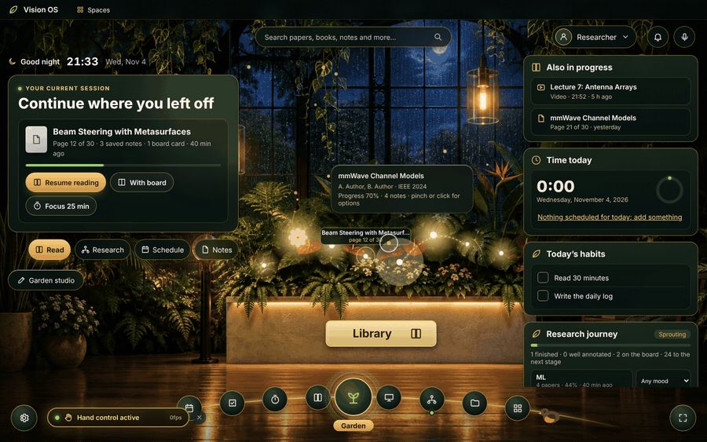
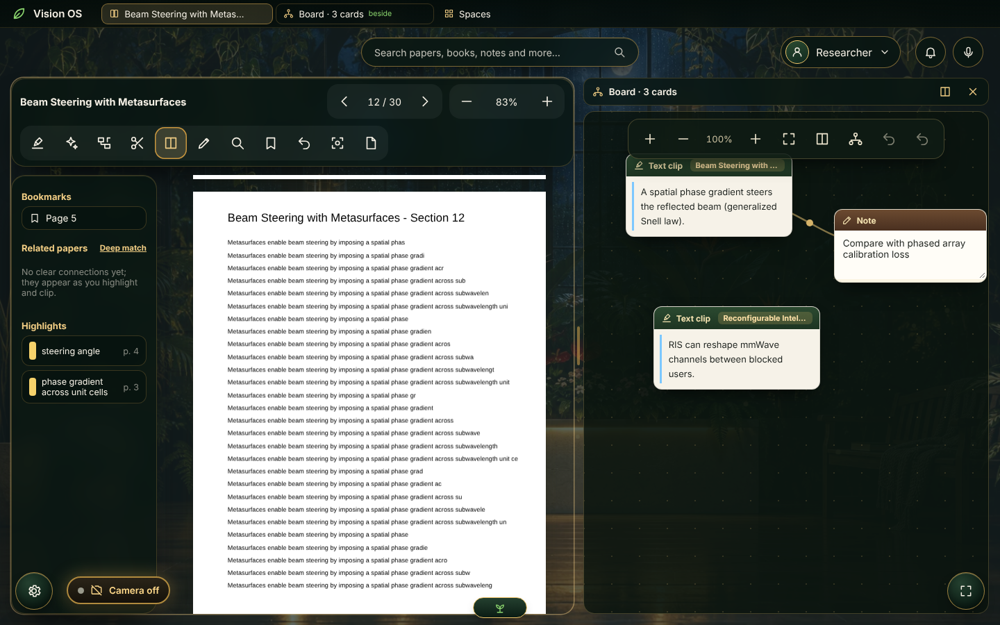
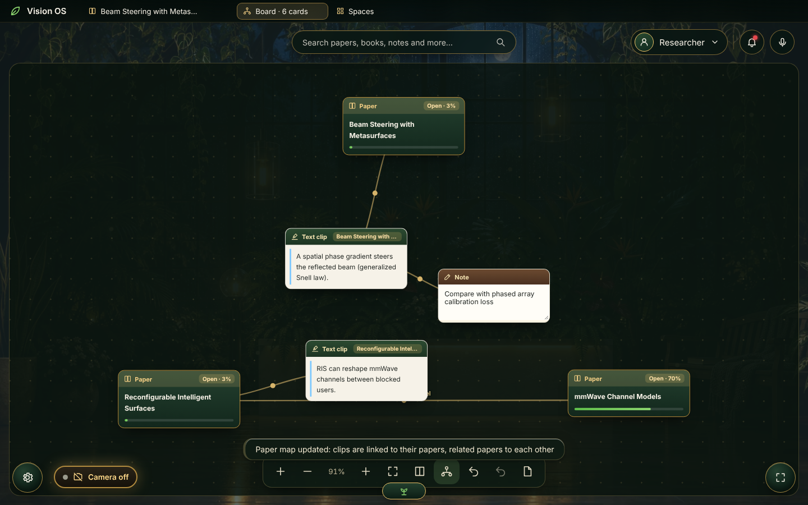

# Vision OS

**A full-screen, vision-first research workspace for Windows, controlled with hand gestures from an ordinary webcam.**

Vision OS is a desktop shell (Tauri + React) that feels like a separate operating system: a lantern-lit greenhouse home screen, a PDF reader, a knowledge board, a focus studio, a YouTube player with timed notes, voice and typed commands, an optional face lock and a local AI research assistant. It also brings together my other apps, [Marginal Research](https://github.com/mohammadaminkhoshkam/Marginal-Research), [HabitWall](https://github.com/mohammadaminkhoshkam/HabitWall) and [Rooznegar](https://github.com/mohammadaminkhoshkam/Rooznegar), by reading their data (read-only).

It is not a kernel or a standalone OS. It runs on top of Windows, and everything (camera processing, AI and data) stays on your computer.



*Pick up where you left off, turn pages with a swipe, carry a highlight onto the board with a pinch, and come back to a garden that remembers (recorded with replayed gesture events).*

## Features

- **A living research workspace.** Home is built around the work in progress rather than the clock: a *current session* card shows the paper or video you were on (page, saved notes, board cards) with one-click *Resume*, *With board* and *Focus* actions, and switches to a running focus session or a schedule item that is about to start when those matter more. A focus session ends with a short summary (minutes, pages, highlights, board cards) and a way straight back to the page.
- **Persistent multi-pane workspace.** Reader, knowledge board and video stay open in the background once used, so switching never loses a scroll position or a playing video. Put a second tool beside the current one behind a draggable splitter (mouse, arrow keys or a pinch), let a started video float in a small player while you work elsewhere, and use the title-bar tabs (with live previews) to move between them. Only the active pane takes shortcuts, menus and voice commands.
- **Research spaces.** Save the whole space (layout, paper and video positions, scene and sound mix) under a name and restore it later from the title bar or `Ctrl+K`. Local PDFs are kept on this computer so they reopen after a restart.
- **A garden that lives with your work.** The scene follows the time of day and the real weather, quiets down during focus and blooms when a session is completed; it calms under work screens and pauses when the window is hidden or the battery is low. The paper you are reading is ringed and labelled with its page, related papers are joined by threads of light, and the garden grows through five stages from meaningful progress (finished, annotated and mapped papers, named connections, focused hours), never from clicks or elapsed time. Each project (collection) remembers its progress and can carry its own mood.
- **Related-paper discovery.** Connections between papers are found on this computer from titles, highlights and board clips, always with the shared terms as evidence; an optional local embedding model deepens the match. New papers in the library come with a suggestion of how they connect to earlier work.
- **Companion.** A small bird beside the dock that blinks, wanders, pecks, sleeps when nobody is at the computer, rests during focus, stretches when a break is due and is happy when petted. It never speaks or pops up and can be turned off.
- **Learn by doing.** A seven-step gesture practice opens the first time hand control turns on (and from the calibration screen); the hand cursor shows a hold ring and a confirmation for every recognised command. A first-session checklist on Home ticks itself off as you open a paper, put a quote on the board, focus and save a space.
- **Hand-gesture control.** MediaPipe hand tracking turns your index knuckle into a cursor. A pinch clicks, a held pinch drags, a V sign scrolls, an open-palm swipe turns pages, a two-hand pinch zooms, and holding an open palm opens a radial menu. Every threshold can be tuned on the *Gestures and calibration* screen.
- **PDF reader.** Text-anchored highlights in several colors, a pen, a precision magnifier, bookmarks, focus mode and a split view with the knowledge board. Papers from your Marginal library open at the page you stopped on.
- **Knowledge board.** Drag (or pinch-carry) highlights, text selections, AI answers, video bookmarks and images onto the canvas, clip with `C`, or draw a box around a figure in the reader. Every card links back to its page or second in the source. Group cards in frames, colour notes, label connections (supports, contradicts…), and build a *paper map* that gathers clips around their papers and links related papers. Pan/zoom, undo/redo and JSON export.
- **Local AI assistant (Ollama).** Explain, simplify, expand, summarize, critique the method, or ask about engineering use, either on the selected text, the current page or a board card. Figure cards are sent to a vision model as images. Answers must cite the page and mark anything unsupported as "(needs checking)". Nothing is sent to a cloud service.
- **Focus studio.** Pomodoro and Flowtime timers that can be linked to a paper, a floating mini-timer, weekly stats by tag, a task list and generated ambient sound (rain, wind, stream, birds). Optional "dew drop" rewards can be spent in the garden. There are no penalties.
- **Garden studio.** Plant and arrange plants and objects in the greenhouse with a snap grid, undo/redo, watering and a garden journal. Each paper in your library grows as a flower that blooms with your reading progress.
- **YouTube player.** Large controls, keyboard and gesture seeking, playback speed, and timed bookmarks and notes.
- **Library, schedule and stats.** All papers and every highlight and note in one place, a daily schedule with on-time reminders, tasks, focus time, Rooznegar time and reading progress.
- **Command bar and voice.** `Ctrl+K` searches papers, videos, board cards and screens, and also runs commands. Voice commands use the same offline parser.
- **Face lock.** An optional lock that opens when it recognizes your face and you blink, with a backup PIN.
- **Moods and appearance.** Night greenhouse (photo), morning, rainy, warm sunset and painted night scenes; a companion bird that rests during focus and celebrates a finished session (can be turned off); a reduced-motion mode; or your Windows wallpaper as the background.

| Home | Reader + board side by side |
|---|---|
|  |  |

| Paper map | Library |
|---|---|
|  |  |

| Focus studio | Settings |
|---|---|
|  |  |

## Requirements

- Windows 10 or 11 with WebView2 (included in current Windows)
- [Node.js](https://nodejs.org) 22.5 or later
- [Rust](https://www.rust-lang.org/tools/install) and the [Tauri prerequisites](https://v2.tauri.app/start/prerequisites/), for the desktop app only
- A webcam, for gestures and face lock (optional)
- [Ollama](https://ollama.com/download), for the AI assistant (optional)

## Install and run

```bash
npm install          # dependencies; also copies the MediaPipe and pdf.js runtime files into public/
npm run app:dev      # run the desktop shell with hot reload
npm run app:build    # build a Windows installer (NSIS), written to src-tauri/target/release/bundle/nsis/
```

You can also run only the interface in a browser at `http://localhost:5280` with `npm run dev`. A small dev server plugin then serves the same local data the desktop app reads.

## Getting started

1. **Turn on the camera.** Click the *Camera off* pill (bottom left) or press `Ctrl+Alt+V`. The camera starts in standby and only watches for the wake gesture.
2. **Wake hand control.** Make fists with both hands, raise them, then open both hands. To turn control off, do the reverse (two open palms → two fists). Lowering your hands pauses control, and `Esc` always stops it immediately.
3. **Calibrate.** Open *Gestures and calibration* from the profile menu to set your dominant hand, the active area (yellow box), cursor smoothing, pinch thresholds and scroll speed, and to try the target test.
4. **Open a paper.** Use *Continue reading* on the home screen, the *Library*, or open any PDF from your computer.
5. **Set up the AI assistant (optional).** Install Ollama (`winget install Ollama.Ollama`), then go to *Settings → Local AI* and install a model. `gemma3:4b` is a good first choice: it reads text and images and fits on a 6 GB graphics card.

## Gestures

| Gesture | Action |
|---|---|
| Two fists → two open palms | Turn hand control on |
| Two open palms → two fists | Turn hand control off |
| Lower your hands | Pause automatically (any drag is released) |
| Move your index knuckle | Move the cursor |
| Short pinch / held pinch | Click / drag (highlight and draw in the reader) |
| V sign + vertical movement | Scroll |
| Open palm + quick horizontal swipe | Turn the page, or skip ±10 s in a video |
| Pinch with both hands, move apart or together | Zoom |
| Hold an open palm still | Radial menu for the current screen |

## Keyboard shortcuts

| Key | Action |
|---|---|
| `Ctrl+Alt+V` | Camera on / off |
| `Esc` | Stop hand control immediately |
| `Ctrl+K` | Command bar: search papers, videos, the board, tools and saved spaces, or run a command |
| `Ctrl+Shift+Space` | Voice command (where speech recognition is available) |
| `Ctrl+Alt+L` | Lock |
| `F11` | Fullscreen |
| `J` / `K` | Reader: next / previous page |
| `B`, `H`, `C`, `A`, `L`, `F` | Reader: bookmark, highlight, clip to board, ask AI, magnifier, focus mode |
| `+` / `−` | Reader: zoom |
| `Ctrl+Z` / `Ctrl+Y`, `Delete` | Knowledge board: undo / redo, delete card |
| `←` / `→` on the splitter | Resize side-by-side panes (double-click resets) |

Shortcuts go to the pane you last touched when two tools are side by side.

## Voice and typed commands

Commands can be spoken or typed into the command bar. Some examples:

- `next page`, `previous page`, `go to page 12`, `zoom in`, `bookmark this`
- `play`, `pause`, `skip forward 30 seconds`, `rewind`, `volume down`
- `open Marginal`, `open habitwall`, `rooznegar`
- `garden`, `knowledge board`, `focus studio`, `settings`, `youtube ofdm lecture`, `open paper ris localization`
- `timer 50 minutes`, `start pomodoro`, `end session`
- `explain this`, `simplify`, `summarize`
- `turn vision on`, `vision off`, `camera off`, `night mode`, `rainy weather`, `sunset`

Speech recognition is often unavailable inside WebView2, but the command bar (`Ctrl+K`) always works.

## Data and privacy

- Camera frames are processed locally and are never stored or sent anywhere. Only hand and face landmark coordinates are used. *Camera off* fully releases the camera.
- The face lock is a personal lock against casual access. A regular webcam has no depth sensor, so it is not as secure as Apple's Face ID. The backup PIN always works.
- Vision OS never changes the data of the apps it connects to. It reads:
  - Marginal Research: `%APPDATA%\marginal-research\workspace`
  - Rooznegar: `%LOCALAPPDATA%\Rooznegar\data.json`
  - HabitWall: `%APPDATA%\app.habitwall.desktop\habitwall.db`
- Its own highlights, notes, board, garden and settings are stored locally by the app.
- The only network requests are the weather (Open-Meteo), YouTube videos you open, and model downloads from Ollama.

## Known limitations

- YouTube search needs an API key, so paste a video link instead.
- Hand control works inside Vision OS only. It does not move the Windows mouse in other apps.
- Board cards clipped from a PDF opened from disk (not from Marginal) cannot reopen their source after a restart.
- Default gesture thresholds are starting points. Calibrate them for your camera and lighting.

## Development

```bash
npm test             # unit tests: gesture state machine, command parser, focus engine, board, garden, face matching, prompts, Rooznegar summary
npm run typecheck
```

## Design inspirations

Ideas (not code) were taken from these open-source projects and adapted to a research workspace:

| Project | Idea used in Vision OS |
|---|---|
| [daedalOS](https://github.com/DustinBrett/daedalOS) | Persistent windows, a task strip with previews, layouts that come back |
| [MewoOS](https://github.com/subhansh-dev/MewoOS) | A companion with its own small behaviours and memory, a lively dock |
| [AFFiNE](https://github.com/toeverything/AFFiNE) | Documents and canvas as one space: quotes, images and AI answers placed directly on the board |
| [tldraw](https://github.com/tldraw/tldraw) | Frames, labelled connections and visual thinking on the board (no tldraw SDK is used) |
| [Lively Wallpaper](https://github.com/rocksdanister/lively) | A living background that pauses when hidden, covered or on battery, and follows the weather |
| [Reor](https://github.com/reorproject/reor) | Local discovery of related notes and papers, with visible evidence |
| [Motion Primitives](https://github.com/ibelick/motion-primitives) | Spring-based UI motion through [Motion](https://motion.dev) (MIT), used for the dock |
| [React Bits](https://github.com/DavidHDev/react-bits) | Restraint with effects: a few subtle, purposeful glows written from scratch (its components are not used) |
| [Puter](https://github.com/HeyPuter/puter) | One app registry that the dock, launcher and hand menu are built from |

A usability test protocol for comparing builds is in [docs/usability-test.md](docs/usability-test.md); the app has a matching study recorder under *Settings → Usability study*.

## Third-party assets

- The hand and face landmark models in `public/models` are from Google [MediaPipe](https://ai.google.dev/edge/mediapipe) (Apache-2.0).
- PDF rendering uses [pdf.js](https://mozilla.github.io/pdf.js/) (Apache-2.0). Interface springs use [Motion](https://motion.dev) (MIT). The UI font is [Inter](https://rsms.me/inter/) (SIL Open Font License).
- The greenhouse background image was generated with Figma AI.
